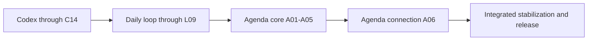

# Three-branch implementation plan and tracker

Last reviewed: **2026-11-15**. This is the shared delivery overview for
`feature/codex-cli-support`, `feature/daily-loop-tuning` and `feature/agenda`.
Keep this filename stable and update the review date as work progresses.

**Goal:** finish the provider-neutral foundation, improve the Daily loop and
integrate non-development commitments without losing completed behavior.

**Architecture (revised 2026-11-15):** land the small, already-tested Daily loop
and Agenda work on `develop` first, so it is exercised in real working days, then
reconcile the provider-neutral core against that `develop` and integrate it. The
original Codex-first order is kept below as history; see
[Status and order update — 2026-11-15](#status-and-order-update--2026-11-15).
Existing ticket specifications remain authoritative for acceptance criteria;
this document owns delivery order, priorities and the cross-branch progress view.

**Tech stack:** existing Python standard library, Markdown skills, unittest,
macOS native integration, Claude Code and Codex CLI.

**Scope:** a delivery plan for existing work, not authorization to start every
ticket, merge, publish or change installed personal data. No implementation or
integration was performed while creating this document. Priority and scheduling
choices below are recommendations based on dependencies and existing specs.

## Status and order update — 2026-11-15

This section supersedes the delivery order, queue and milestone sequence in the
older sections below where they disagree. Those sections remain as history and
for their per-milestone checklists.

**C14 is accepted.** Commit `8702d8c` (2026-11-14) records cross-Provider native
acceptance: both native defaults, both real switch directions, source/history
unavailable recovery and exact same-ID resume. It found and repaired
C14-CODEX-03 (a reused Codex daemon kept another launch's environment; Deskmate
now launches Codex with `--no-daemon`). 279/279 full tests, 70/70 system-Python
checks, independent review without findings. Evidence:
`feature/codex-cli-support:docs/testing/c14-cross-provider-2026-11-14.md`.
Calendar import and launchd scheduling are separate platform follow-ups, not
part of C14. C15/C16 (launch start check, morning reminder after power-off,
specified in `67cc376`) are outside the 29-ticket count and not implemented;
the owner decides whether they precede Codex integration.

**Implementation count: 24 of 29.** Remaining: L05–L08 and A06. L09 landed as a hotfix on `develop` (`51ba159`, merged in `dfd7636`).

**New integration order, decided by the owner on 2026-11-15:**

1. **L09 hotfix on `develop`.** `check.py <name>` crashes today on a tool used
   every morning. Implement it against the current card location
   (`~/.claude/projects/*/memory/project-card.md`); the Codex reconciliation
   later moves its lookup onto the shared Project card helper.
2. **`feature/daily-loop-tuning` (L01–L04) → `develop`.** Already based on
   `develop`; expected minor conflict with the L09 hotfix in `tools/check.py`.
3. **`feature/agenda` (A01–A05) → `develop`.** Three small text conflicts with
   Daily loop (README, `how-did-it-go`, `whats-on-today`): both sides add a
   paragraph at the same point; keep both.
4. **Merge `develop` into `feature/codex-cli-support`** and reconcile there, where
   the full suite runs. This replaces INT-L/INT-A below in direction only; their
   checklists still apply. Known hard spots:
   - `tools/log_event.sh`, `tools/hook_tokens.sh`, `tools/hook_log.sh` are deleted
     on Codex and modified on Daily loop/Agenda (modify/delete conflicts);
   - Daily loop's `tools/usage_log.py` (`usage_scope`, precise `<skill>-end`
     events, preserved extension columns) must be carried into Codex's
     `tools/activity_log.py`/`tools/hook_event.py`; `tools/token_usage.py` and
     `tests/test_activity_log.py` conflict heavily;
   - Agenda's one-line `hook_log.sh` change (add `agenda` to the logged skills)
     must become an addition to `SKILLS` in `tools/hook_event.py`, which Git will
     **not** flag; Agenda's `install.sh` initialization moves into the Codex
     installer;
   - after resolving, `git grep -E "hook_log|log_event|hook_tokens"` must find no
     live callers.
5. **`feature/codex-cli-support` → `develop`**, then rerun `/setup` so the
   installed hooks and card migration take effect.
6. Afterwards: L05, L08, L06, L07 on a Daily-loop follow-up branch from
   `develop`; then A06.

Why the change: Daily loop and Agenda are small, tested and immediately useful;
`develop` is what the installed skills link to, so merging them there tests them
in real days. Codex replaces hooks, installer and log writer, so it lands better
on a base already exercised in use. Development is agent-driven, so doing the
reconciliation once on the Codex branch costs the owner little. The
`feature/daily-loop-tuning` plan's "merge after Codex" note is superseded by
this decision.

**Related roadmap item:** project-card versioning (`ROADMAP.md`) depends on
where cards live after Codex (`<DESKMATE_DATA_DIR>/projects/<key>/project-card.md`
with revisioned `card write`, per the shared-cards design). It needs a design
session before implementation.

**Evidence location:** C14 evidence lives on `feature/codex-cli-support` under
`docs/testing/` (the untracked copies formerly in the `develop` checkout were
committed there in `d57e23d`). Links from this document to `../../testing/`
resolve once Codex is merged; until then use
`git show feature/codex-cli-support:docs/testing/<file>`.

## Current position

**22 of 29 tickets are implemented; 7 remain.** Ticket counts do not measure
remaining effort: transfer security, installation and end-to-end acceptance are
substantial parts of the remaining work. C14 has a verified synthetic checkpoint
at `24b431f`, followed by timestamp fix `8ab2f78`, but stays unchecked until its
explicit native acceptance criteria are met. Codex native requests were
authorized and executed. Claude-only native acceptance was authorized and
launched on 2026-11-13 alongside C14-CODEX-02 diagnosis. That finding is now
triaged as a documented bounded runtime limitation with tests and evidence;
Claude execution found C14-CLAUDE-01, repaired in `ecf9109`. The original
native fixture now resumes through Deskmate in real iTerm, with verified
identity/folder/hooks/Check and exit 0; evidence is committed in `f22022e`.
Selected launch environment is also repaired (`31f3cc6`) and natively verified
without a transport wrapper (`0182bd8`). The owner has now explicitly lifted the cross-Provider quota hold and requested
its native test group; execution is in progress.

| Stream | Implemented | Remaining | Local tip inspected | Latest recorded automated evidence | Integrated into develop |
| --- | --- | --- | --- | --- | --- |
| Codex CLI (`C`) | C01–C13: 13/14 | C14: cross-Provider acceptance and remaining observations; SQLite limitation triaged | `0182bd8` | 277 full tests in preparation/destination + 118 system-Python checks; approved review; real Claude no-wrapper environment/resume/Check/lifecycle verified | No |
| Daily loop (`L`) | L01–L04: 4/9 | L05–L09: 5 | `9e788dc` (branch); `e79016f` (worktree) | 19 tests at `e79016f`; newer commit adds only the L09 specification | No |
| Agenda (`A`) | A01–A05: 5/6 | A06: 1 | `2f514e1` | 40 tests on Python 3.9.6 and 3.14.6 | No |

`develop` and `main` were both at `70468e3` when inspected. All feature worktrees
were clean on 2026-11-10. The local `feature/daily-loop-tuning` branch and locally
known remote ref are at `9e788dc`, which adds the unimplemented L09 specification.
The managed detached Daily-loop worktree remains at `e79016f`, one documentation
commit behind. Before continuing that stream, attach/reuse the intended branch
through the workspace controls and retain L09; do not resume from the detached
worktree without accounting for that newer specification.

The initial inventory used local Git refs without a fetch or a new test run.
Subsequent implementation and actual test evidence are recorded in the update log.
The feature test totals are separate baselines, not an integrated test count.

### How to read status

- A checked ticket means implementation and its recorded automated/local
  acceptance are complete. It does **not** mean merged, released or accepted in
  authenticated native sessions.
- `ready` means ticket prerequisites are implemented on its own branch;
  `blocked` names unfinished dependencies. The execution sequence may defer a
  ready ticket to reduce changes to shared files.
- Local tracker `Status: ready-for-agent` is a triage role and can remain on an
  implemented ticket. Use its `Implementation` line, acceptance checklist and
  evidence to establish development progress.

## Delivery strategy and priorities

Use a **foundation-first integration order with limited independent preparation**.
The existing workflow requires the complete Codex effort, including C14, before
its merge into `develop`. Both other specs require integration after Codex.
Keeping that order avoids maintaining two card locations, hook systems and log
writers while reconciling three versions of the same skills.

Two alternatives were considered. Merging Agenda/Daily loop first would make
some visible improvements available sooner, but would reverse their documented
integration dependency and require a deliberate workflow change. Fully
implementing all streams concurrently preserves the approved independent
worktree model, but increases reconciliation work in the shared skills and
logging code. Independent tool/test preparation is useful; concurrent changes
to the same behavior should be kept small and reconciled by one integrator.

| Priority | Meaning | Tickets |
| --- | --- | --- |
| P1 | Required delivery path or high-value unblocker; execute when prerequisites permit | C09–C14, L05, L08, L09, A06 |
| P2 | Useful planning improvements after the foundation and unblockers | L06, L07 |

C14 and A06 have high priority, but priority does not override acceptance and
integration dependencies. **C13 is complete at `3b0c510`; C11 is complete at
`b10d282`**, including synthetic instruction acceptance and reviewed regression
fixes. C14 synthetic implementation and its independent whole-feature review are
complete at `24b431f`; both Important review findings were fixed with RED/GREEN
regressions. Its authenticated native acceptance remains on the recorded quota
hold, so C14 and M1 remain open. L09 is a P1 unblocker because rechecking a project by name
currently crashes; its implementation must use shared Project card discovery
after Codex integration.

### Recommended execution queue

| Order | Ticket | Priority | Current readiness | Why this position / dependencies |
| --- | --- | --- | --- | --- |
| 1 | C09 — degradable Provider switch | P1 | implemented (`b81b268`) | Core purpose: continue work when a Provider is exhausted. C03/C07 are implemented. |
| 2 | C10 — secure context transfer | P1 | implemented (`8e34b5a`) | Completes the switch with bounded context, preview, redaction and explicit consent. C06/C08/C09 are implemented. |
| 3 | C12 — reminders for both Providers | P1 | implemented (`e375535`) | Default-first native forms, calendar text and displayed-Provider response attribution verified. |
| 4 | C13 — installation, migration and removal | P1 | implemented (`3b0c510`) | Common setup/remove, recoverable migration and ownership-preserving removal verified in isolated homes. |
| 5 | C11 — progressive retrospective | P1 | implemented (`b10d282`) | Uses C03/C06/C08; complete after the core switch/install path, before C14. |
| 6 | C14 — clean cut and complete Daily-loop validation | P1 | Codex/Claude native groups recorded; fixes through 31f3cc6 and no-wrapper evidence 0182bd8 | Cross-Provider acceptance remains held; record remaining platform observations separately before integration. |
| 7 | L05 — retrospective every two development days | P1 | ready on Daily-loop branch | First Daily-loop implementation after core reconciliation; unblocks A06. Use logs until Agenda is integrated. |
| 8 | L08 — morning login checks | P1 | ready for synthetic implementation | Addresses repeated interruptions. Confirm the required Logins before changing the owner's real Project cards. |
| 9 | L09 — check by project name | P1 | ready on Daily-loop branch | Preserve card-path input; resolve names against shared cards, report missing/ambiguous matches without a traceback, and test synthetic cards. |
| 10 | L06 — goal of the day | P2 | ready | Establish a confirmed goal and evening outcome before adding project-switch analysis. |
| 11 | L07 — priorities and project-switch log | P2 | ready | Build on the planning view; L06-before-L07 is a scheduling choice, not a formal ticket dependency. |
| 12 | A06 — connect Agenda and Daily-loop rules | P1 | blocked | Execute after L03/L05 and Agenda core are on `develop`; exclude non-development days from cadence and explain them in stale Handoffs. |

Completing C11 does not lift the recorded native-acceptance hold. Within
Daily loop, L08's read-only checker and fake-command tests can be prepared while
Codex is being completed. This is optional parallel work, not a new dependency
or a request to start extra agents. Defer overlapping skill rewrites to the
relevant reconciliation phase.

## Milestones and integration gates



Each arrow includes integration into `develop` and validation before the next
feature lands. Development in isolated branches can overlap as described above.
Preserve the distinction between a completed ticket and a completed feature.

### M1 — Complete and integrate Codex

- [ ] Implement C09 → C10 → C12 → C13 → C11 → C14 on the existing feature branch.
- [x] C09 tests cover unavailable source Provider/transcript, a genuinely new
  target session, overlap confirmation, cancellation and failed target launch
  without stealing Project card ownership.
- [x] C10 tests cover preview/redaction counts, uncertain findings, consent,
  private path-only bundles, consumption/expiry cleanup and content-free audit
  records. Keep partial C09 work as a development checkpoint until the secure
  transfer path is complete.
- [x] C12/C13 tests cover Claude-only, Codex-only and dual installations,
  default ordering, repeated setup, migration backups, unrelated configuration,
  required trust guidance and data preservation on removal.
- [x] C11 tests prove durable data is inspected first, all candidate sessions are
  visible, at most five are recommended, and deltas are read only after selection.
- [x] C14 verifies all native skill/hook/reminder entry points use the final
  command interface; obsolete Claude-only entry points are removed as specified.
- [ ] Complete the authenticated acceptance matrix below when the owner lifts
  the previously recorded native-model-request hold. Until then, continue
  synthetic development and leave native acceptance pending.
- [ ] Review the complete feature, promote durable tracker decisions into docs,
  preserve the existing `develop` fetch behavior and merge into `develop` under
  the applicable integration authorization. Run the full suite on the result.

The complete-C14 gate is inherited from
`feature/codex-cli-support:docs/agents/development-workflow.md`. This plan does
not replace it with a merge after C09 or C10.

#### C14 native acceptance — separate execution groups

The owner postponed native requests and then asked to separate Codex and Claude
acceptance. Run and record the following groups independently in dedicated
non-sensitive projects. **Codex-only native execution completed on 2026-11-11. Timestamp finding
C14-CODEX-01 is resolved in `8ab2f78`; separate post-exit SQLite finding
C14-CODEX-02 was triaged on 2026-11-13 as a documented bounded runtime
limitation. Claude-only testing completed on 2026-11-13 with open finding
C14-CLAUDE-01. Repair `ecf9109` passes automated checks and a real native
Deskmate/iTerm resume; follow-up evidence is committed as `f22022e`.
Cross-Provider testing remains pending and on hold.**
Authorization to run one Provider's group does not authorize requests to the
other Provider or the cross-Provider group.

| Group | Native requests | Current status |
| --- | --- | --- |
| Codex | Codex only | Execution complete; C14-CODEX-01 fixed in `8ab2f78` with a fresh native regression; post-exit SQLite C14-CODEX-02 triaged as a documented bounded limitation |
| Claude | Claude only | Executed; indexless resume fixed ecf9109, launch environment fixed 31f3cc6 and native no-wrapper resume verified 0182bd8; manual Check approved by owner, folder-trust dialog not reopened |
| Cross-Provider | Both Providers, including both switch directions | Authorized on 2026-11-13; native execution in progress at 0182bd8, Codex CLI 0.168.0 |

**Codex group** — can finish while Claude acceptance is postponed:

- [x] Verify native `$setup` and discovery of all five Daily-loop skills;
  review the normal project and `/hooks` trust prompts.
- [x] Invoke a skill and verify actual prompt/Stop delivery, Codex attribution,
  native session identity and project path in the isolated log.
- [x] Save a Checkpoint and verify same-Provider resume against the actual
  Codex session and shared Project card.
- [x] Complete morning → Checkpoint → selected retrospective → evening Handoff
  using Codex, recording actual outputs and degraded outcomes.

These checkmarks record executed scenarios and their evidence. The initial
CET-format finding C14-CODEX-01 is resolved in `8ab2f78`: shared validation
prevents invalid publication, and a fresh native Checkpoint/selected-retrospective
run passed without formatting hints. See [timestamp correction and evidence](../../testing/c14-codex-timestamp-fix-2026-11-11.md).
A supplementary post-exit read-only SQLite probe degraded when native WAL/SHM
sidecars were absent; a diagnostic SELECT through a read-write connection restored
read-only access. This separate lifecycle finding is C14-CODEX-02. The
[2026-11-13 investigation](../../testing/c14-codex-sqlite-2026-11-13.md)
triages it as a documented bounded runtime limitation, retaining strict read-only
access and explicit degraded coverage. Cold history is not claimed reliable;
C14 and M1 remain incomplete.

**Claude group** — can finish while Codex acceptance is postponed:

- [x] Verify native `/setup` and discovery of all five Daily-loop skills.
- [x] Record normal runtime approvals: initially auto mode; the native follow-up
  observed a manual-mode command approval and its execution. The approving person
  is inferred; the existing fixture's folder-trust dialog was not reopened.
- [x] Invoke skills and verify actual prompt/Stop delivery, Claude attribution,
  native session identity and project path in the isolated log.
- [x] Save a Checkpoint and verify same-Provider resume through Deskmate against
  the actual Claude session and shared Project card. Original revisions 1/2 and
  direct native resume passed; C14-CLAUDE-01 was then fixed and real Deskmate
  launch/resume verified with matching lifecycle hooks, journal, ID and folder.
  Ownership confirmation advances revision 2 to 3 without changing owner/body.
  See [native resume evidence](../../testing/c14-claude-native-resume-2026-11-13.md).
- [x] Complete morning → Checkpoint → selected retrospective → evening Handoff
  using Claude, recording actual outputs, native-resume workaround and degraded
  metadata. See [Claude evidence](../../testing/c14-claude-native-2026-11-13.md).

**Cross-Provider group** — schedule when requests to both Providers are authorized:

- [ ] Verify dual installation with each Default provider, default-first
  reminders, unowned routing and the same shared skill/card content.
- [ ] Verify a real Claude → Codex switch with preview, explicit consent,
  a new target identity, confirmed ownership and transfer consumption/deletion.
- [ ] Verify the same guarantees for a real Codex → Claude switch.
- [ ] Verify continuation from the card and live Checks when the source runtime
  or history is unavailable, with explicit missing-context disclosure.

Record date, source commit, CLI versions, native session identities, commands and
observed evidence per group. Setup-twice preflight with real CLI capability probes
already passed for the four installation configurations; it does not mark native
skill discovery, hook delivery or any group above as passed. Keep desktop/calendar
observations separate as specified by `docs/testing/daily-loop.md` on the feature
branch. This grouping preserves the existing C14 acceptance criteria: partial
acceptance does not close C14 or permit its integration into `develop`.

### Resume checkpoint — 2026-11-12

The owner requested stopping on 2026-11-11 and continuing tomorrow. Stop work
at this checkpoint; the remaining list records scope, not new authorization
to run held native groups.

Implementation is committed locally on `feature/codex-cli-support` at
`8ab2f78` in `/Users/mario.corsanici@domyn.com/Dev/mc_dev/deskmate-codex`.
That feature worktree is clean. C14-CODEX-01 is resolved: shared publication/read
validation and system-generated UTC timestamps passed 253/253 full tests,
47/47 focused tests on Python 3.14.6 and 3.9.6, independent review, and a fresh
native Checkpoint/selected-retrospective regression without formatting hints.
No push or merge has been performed. This shared tracker is in the `develop`
checkout with existing uncommitted README/docs work; preserve those changes.

The owner also requested a ready-to-paste prompt for the Claude-only tests.
The complete [Claude native test prompt](../../testing/c14-claude-native-prompt.md)
is saved, including isolation, real native scenarios, evidence paths and scope
limits. It has not been executed; preparing or saving the prompt does not lift
the native-request hold. When the owner launches that work, use the saved prompt
and verify the current branch/commit rather than assuming the recorded tip is
still current. Cross-Provider testing remains separately held.

Remaining for C14, in the intended resumption order:

- [x] **C14-CODEX-02 triaged on 2026-11-13:** reproduce cold read-only access to native
  paginated history after CLI exit, with WAL/SHM sidecars absent. Capture the
  initial failure before any read-write connection can recreate the sidecars.
  Determine the cause and either correct it with regression/native evidence or
  establish the documented bounded degradation and recovery behavior.
- [ ] Execute the Claude-only native group when its hold is lifted: setup and
  skill discovery, hook approvals and actual logging, Checkpoint/resume, and
  morning → selected retrospective → evening Handoff.
- [ ] Execute the cross-Provider group when authorized: both defaults and shared
  state, real switches in both directions with consent/new identity/ownership,
  transfer consumption/deletion, and recovery without the source or history.
- [ ] Record desktop notifications/responses, real calendar import and any
  remaining native terminal-launch observations separately from model tests.
- [ ] Consolidate acceptance evidence, resolve findings, run checks appropriate
  to any changes and update C14's remaining acceptance checkboxes. Prepare
  integration into `develop` only after C14 is complete and integration is
  authorized.

Durable evidence: [initial Codex run](../../testing/c14-codex-native-2026-11-11.md)
and [timestamp fix plus SQLite follow-up](../../testing/c14-codex-timestamp-fix-2026-11-11.md),
each with linked JSON. The temporary runtime under
`/private/tmp/deskmate-c14-codex-20261111-57yyvc_9` may disappear; rebuild isolated
fixtures if needed. Native processes have exited and temporary authentication
references were removed. Preserve the original observations: the warmed SQLite
read is not proof that cold read-only access works. C14 and M1 remain open;
implementation count stays 22/29.

### Parallel resumption — 2026-11-13

The owner authorized running C14-CODEX-02 diagnosis and Claude-only native
acceptance concurrently, with Claude visible in a horizontal iTerm split.
This lifts the Claude-only native-request hold for this run. Cross-Provider
requests remain held; no push, merge or personal integration changes are part
of this work.

Both tasks use isolated local copies of `feature/codex-cli-support` at
`8ab2f78`, separate from each other and from the original feature worktree.
The Claude coordinator has started in iTerm session
`063AB4A9-B197-4FF1-88D6-220B055ABB0F`; normal runtime permissions remain in
effect. Its launch alone is not native skill acceptance. The coordinator
must record actual discovery, hooks, Checkpoint/resume and Daily-loop results,
including failed or pending scenarios. SQLite diagnosis separately preserves
the initial cold failure before any connection can warm the databases.

Run locations and source identity are recorded in
[the parallel-run manifest](../../testing/c14-parallel-run-2026-11-13.json).
Temporary runtime paths may disappear; copy completed evidence into the
repository before relying on it as durable acceptance. C14 and M1 remain open.

C14-CODEX-02 diagnosis is complete: cold metadata/history access reproduces
`SQLITE_CANTOPEN` inside and outside the sandbox on the installed SQLite 3.51.0
runtime. The public commands retain explicit unavailable coverage and preserve
native storage. Fixture-modeled lifecycle recovery succeeds; a new native CLI
reopen was not exercised. Keep the strict read-only reader; do not add writable
or immutable repair fallbacks. Two public-command regressions protect cold
behavior and committed live-WAL freshness. Preparation full suite: 255/255;
system-Python adapter/delta suite: 51/51; independent review approved. Tests,
contract clarification and evidence were applied to the original feature
worktree without commit/push/merge. Destination full suite passed 255/255
in 104.086 seconds, with ResourceWarnings treated as errors.
The [investigation](../../testing/c14-codex-sqlite-2026-11-13.md) preserves
accepted observations and an explicitly invalidated intermediate harness capture.

The initial Claude-only native execution found
**C14-CLAUDE-01**. The authenticated fixture session
`85b0fc6e-17b9-4d11-a788-c47ee19232eb` ran setup, native skill discovery,
morning, study, Checkpoint revisions 1/2, selected retrospective with bounded
delta and lessons, and evening Handoff. Actual hooks have matching Claude
attribution, native ID and project path; both new and resumed processes exited 0.
Direct native `claude --resume` works, but Deskmate `work-session --dry-run`
returns exit 4, `session_unavailable`: the adapter requires a
`sessions-index.json` file absent in this Claude Code 2.1.323 fixture. This also
degrades session metadata. The finding was independently rechecked during the
status update; no implementation repair was attempted.

The initial isolated login blocker was overcome using the owner-approved
Keychain-directory symlink documented in the Claude evidence. The temporary
link was removed after native processes exited; no credential values are
included in the evidence. Manual trust/permission dialogs were not exercised
because the runtime used its default auto mode, with no bypass. Desktop and
calendar channels were disabled. The final
[Claude evidence](../../testing/c14-claude-native-2026-11-13.md) and JSON have
been copied from the temporary clone into this checkout, replacing the partial
login checkpoint.

The owner then requested committing Codex work and resuming C14. Commit
`3fe01e7` preserves the Codex cold-WAL tests/docs; `ecf9109` repairs Claude
indexless resume using native lifecycle metadata plus a unique transcript.
RED/GREEN tests cover metadata-only eligibility/discovery and recent activity;
263/263 full tests passed in preparation (107.043s) and destination (109.403s),
76/76 routing/adapter/delta checks passed on system Python (65.110s), and an
independent reviewer approved without findings. Commit `f22022e` records a real
Deskmate/iTerm resume of the original fixture: matching ID/folder, confirmed and
ended launch journal, read-only Check ok, native exit 0. The native follow-up
observed a manual-mode approval; approver identity is inferred. Its temporary
auth link was removed, and no source changes occurred during native execution.

The earlier isolated test explicitly used an osascript transport wrapper to carry
HOME/PATH into iTerm; that run alone did not prove production custom-HOME propagation.
The owner subsequently authorized the targeted environment correction: `31f3cc6`
pins selected CLI/HOME/PATH/ZDOTDIR/native config/data in both adapters and aligns
Claude config consumers. zsh startup is retained under the selected home, then
selected values are reapplied. Full suites passed 277/277 in preparation and
destination, 118/118 relevant checks passed on system Python, all three actual
AppleScript programs compiled outside the sandbox, and independent review approved.
The [no-wrapper native follow-up](../../testing/c14-launch-environment-native-2026-11-13.md),
committed as `0182bd8`, confirms real Claude resume with selected process/native
environment, Check exit 0 after owner approval, matching hooks/journal, native
process absent and auth-link removal. The CLI numeric exit status was not exposed
by iTerm. Latest Codex environment behavior has automated coverage only; no new
Codex or cross-Provider native request was made.
The [follow-up report](../../testing/c14-claude-native-resume-2026-11-13.md)
records that limit and the remove/setup needed to repoint the fixture. Source
worktree is clean at `0182bd8`; no push or merge was performed. Native new-session
launch, focus-existing-tab, visible folder-trust dialog, desktop notifications
and calendar observations are not covered by this follow-up. The user was asked
asynchronously whether to lift the cross-Provider quota hold; no answer has been
received, so those native requests remain held. C14 and M1 remain open.

### M2 — Reconcile, complete and integrate Daily loop

- [ ] After M1, update Daily loop against `develop`; resolve semantics as well as
  Git conflicts. Keep the shared Project card helper and final command boundary.
- [ ] **INT-L: reconcile logging and metrics.** Preserve Codex's
  `schema_version`/`provider` fields and Daily loop's `usage_scope` plus precise
  end events. Appending, migration and recomputation must share one effective
  locking/atomic-write strategy and preserve unknown columns and history.
- [ ] Retain both versions' scenarios when combining
  `tests/test_activity_log.py`. Check Provider-plus-native-session identity,
  repeated skill invocations, end markers, legacy windows and raw Provider
  metrics without mixing incompatible counters.
- [ ] Preserve L01–L03 remote freshness, failed-fetch uncertainty, remote-change
  reconciliation and stale-Handoff facts. Keep the Handoff's intent separate
  from live verified state.
- [ ] Implement L05 → L08 → L09 → L06 → L07 in focused ticket commits. L05 initially
  counts log-defined development days; it must not import an Agenda tool that
  exists only on another worktree.
- [ ] L09 preserves existing card-path input and resolves project names through
  the shared Project card helper. Cover unique, ambiguous and missing matches
  using synthetic cards; list candidates and exit non-zero without tracebacks.
  Update skill instructions to explain both input forms.
- [ ] L08 tests use fake login commands, short timeouts and exit codes only;
  never print tokens or automatically run login repairs. Treat the documented
  1Password desktop authorization case as a warning. Owner confirmation is
  required for the Logins list on the two named personal Project cards.
- [ ] Verify goal confirmation/outcome, the high/low planning view, recorded
  switch reasons, the two-day cadence and at-most-three retrospective points
  per section. Exercise instruction changes with actual scenario application,
  not tests that merely search Markdown for phrases.
- [ ] Review the reconciled feature, complete applicable native scenarios, promote
  durable evidence and merge into `develop`. Run the combined full suite.

### M3 — Reconcile and integrate Agenda core

A01–A05 are an independently useful core. A06 is explicitly a post-integration
connection in the Agenda spec. Treat these as two delivery boundaries: this
avoids requiring A06 before the very integration that unblocks it.

- [ ] Update Agenda against M2's `develop`; preserve the completed CLI's locking,
  invalid-line/byte preservation, archive lookups and macOS Python compatibility.
- [ ] **INT-A: adapt the new skill to both Providers.** Integrate Agenda into the
  final command/installation conventions, native skill metadata and hook
  allowlists. Confirm `/agenda` and `$agenda` discovery and logging with Provider,
  native session identity and arguments; preserve unrelated hooks/configuration.
- [ ] Keep the provider-neutral hook facade. Agenda's old shell allowlist alone
  does not update the newer `tools/hook_event.py` skill registry. Adapt hook tests
  to the real native payloads and public command boundary.
- [ ] Ensure the common installer initializes a missing agenda only and leaves an
  existing agenda byte-identical. Retain the documented data-root behavior.
- [ ] Reconcile the morning early return/half-day plan, evening updates and
  retrospective task completions with M2's cadence, goal, priorities and logins.
  A whole non-development day must not trigger project checks, login probes or
  session launch unless the user asks.
- [ ] Apply the final skill-completion measurement convention to Agenda as well;
  the new skill must not reintroduce unbounded/misattributed usage windows.
- [ ] Run combined synthetic tests and instruction scenarios for both Providers;
  record any native acceptance separately. Promote durable tracker evidence and
  integrate A01–A05 into `develop`, explicitly leaving A06 open.

INT-L and INT-A are integration work, not additional numbered feature tickets.
They are excluded from the 29-ticket count but are required milestone work.

### M4 — Implement the Agenda/Daily-loop connection

- [ ] Confirm L03/L05 and A01–A05 are present on `develop`. Start A06 from that
  integrated state in an isolated follow-up; do not import files from another
  feature worktree. The follow-up can have its own branch based on `develop`.
- [ ] Use `agenda.py is-dev-day` (including historical archives) to exclude whole
  non-development days from the retrospective development-day count.
- [ ] Name intervening non-development days in stale-Handoff disclosure without
  presenting an old Handoff as current. Preserve the documented precedence of
  exit 3 over exit 2 and report invalid-line diagnostics.
- [ ] Verify travel/leave, archived days, half days, malformed agenda lines and
  a Handoff spanning non-development days. Confirm the two-day retrospective
  rule, live-state source and Agenda early return still agree.
- [ ] Review and integrate A06, run the complete combined suite and update this
  tracker to 29/29 implemented only after its evidence exists.

### M5 — Stabilize and release

- [ ] Validate the final integrated morning → Checkpoint → retrospective →
  evening loop with Claude only, Codex only and both installed, including Agenda.
- [ ] Record native skill discovery, hook approval/logging, same-Provider resume,
  a switch in both directions and transcript-unavailable recovery.
- [ ] Confirm migrations preserve personal data, unrelated hooks and existing
  configuration; run setup twice and verify removal preserves data by default.
- [ ] Stabilize on `develop`, promote the validated result to `main` and tag it
  only after choosing the release version/tag convention.

CI, branch protection, Slack/calendar extensions, other operating systems and
normalized cross-Provider analytics remain roadmap work, outside these tickets.

## Ticket checklist

Keep this checklist and the readiness/queue table in sync. A checkbox records
implementation, while milestone checkboxes record integration and acceptance.

| Complete | ID | Deliverable |
| --- | --- | --- |
| [x] | C01 | Provider-neutral command |
| [x] | C02 | Provider detection and configuration |
| [x] | C03 | Shared Project cards |
| [x] | C04 | Claude Provider adapter |
| [x] | C05 | Codex Provider adapter |
| [x] | C06 | Provider-aware logs and metrics |
| [x] | C07 | Work-session routing and ownership |
| [x] | C08 | Bounded Session deltas |
| [x] | C09 | Degradable Provider switch |
| [x] | C10 | Secure cross-Provider transfers |
| [x] | C11 | Progressive retrospective |
| [x] | C12 | Dual-Provider reminders |
| [x] | C13 | Installation, migration and removal |
| [x] | C14 | Clean cut and native Daily-loop acceptance; cross-Provider acceptance passed (`8702d8c`) |
| [x] | L01 | Checks read remote ticket state |
| [x] | L02 | Morning remote-change report |
| [x] | L03 | Stale-Handoff disclosure |
| [x] | L04 | Explicit skill completion and bounded token metrics |
| [ ] | L05 | Retrospective every two development days |
| [ ] | L06 | Goal of the day |
| [ ] | L07 | High/low priorities and project-switch log |
| [ ] | L08 | Morning login checks |
| [x] | L09 | Check a Project card by project name or existing path (hotfix on `develop`, `51ba159`) |
| [x] | A01 | Agenda CLI and contract tests |
| [x] | A02 | Agenda skill, logging and initial installation |
| [x] | A03 | Morning Agenda integration |
| [x] | A04 | Evening Agenda integration |
| [x] | A05 | Closed Agenda tasks in the retrospective |
| [ ] | A06 | Non-development days in cadence and stale-Handoff rules |

## Verification and ownership rules

At each ticket boundary: complete its acceptance checklist, run the relevant full
suite, review its change range, record actual command/results, commit the focused
work and update this document's checklist, counts, next action and change log.
Publish checkpoints only when publication is included in the authorized task.
One integrator updates `develop` at a time. Independent work uses separate
worktrees and explicit ownership of shared-file edits.

The current baseline command is:

```sh
PYTHONDONTWRITEBYTECODE=1 python3 -B -Werror::ResourceWarning -m unittest discover -s tests -q
```

Run it in the branch being verified, using temporary fixture data. Also retain
system-Python compatibility checks where required. Test totals will change;
record observed totals instead of adding the three separate baselines together.

Authenticated native acceptance remains incomplete. The owner previously postponed
native model requests to preserve quota, then authorized Codex-only execution
and, on 2026-11-13, Claude-only execution. Cross-Provider requests remain held.
Synthetic tests and instruction scenarios support development, and do not
substitute for C14/M5 acceptance. Record unavailable native
checks as pending/blocked rather than passed.

### Update log

| Date | Change | Implementation count | Next primary action |
| --- | --- | --- | --- |
| 2026-11-09 | Consolidated the three branch trackers. C08 is implemented at `48feaf6`; Agenda core and Daily-loop 01–04 retain their recorded evidence. Set the queue and integration gates above. | 17/28 | C09 on `feature/codex-cli-support` |
| 2026-11-09 | Owner requested autonomous execution of point 1. Session `/root` started C09 in the existing Codex worktree; baseline 157/157 passed and six new switch tests passed after RED. Full-suite verification and C10 protection work follow. Native quota-hold clarification is pending. | 17/28 | Complete C09, then C10 |
| 2026-11-09 | C09 completed and committed as `b81b268`; full suite 163/163 passed. C10 protection tests are being written/executed. | 18/28 | C10 |
| 2026-11-09 | Owner requested stopping at the next committed/pushed ticket. C10 is that boundary; finish its tests/review/commit, then stop. C11–C14 have not been started. | 18/28 | Finish C10 and stop |
| 2026-11-09 | C10 implementation verified: full suite 180/180; all 23 switch/transfer tests also pass on system Python. Four Important review findings fixed with RED/GREEN regressions; one overly generic transcript warning is a deferred Minor. Evidence is `feature/codex-cli-support:docs/testing/provider-switches.md`. | 19/28 | Commit C10 and stop |
| 2026-11-09 | C10 committed locally as `8e34b5a`; Codex worktree clean. Execution stopped at the owner's requested boundary. No push/merge; C11–C14 remain unstarted. | 19/28 | Stopped; C12 is next when resumed |
| 2026-11-09 | Owner resumed the next scheduled ticket. Session `/root` started C12 in the existing `deskmate-codex` worktree on `feature/codex-cli-support`. Baseline 180/180 passed; new reminder scenarios reproduced the missing Codex syntax and incorrect Claude-only response attribution. | 19/28 | Complete C12 only |
| 2026-11-09 | C12 completed and committed locally as `e375535`; feature worktree clean. Full suite 193/193 on Python 3.14.6; reminder suite 13/13 also on system Python 3.9.6. Independent review's attribution race and CSV error regression fixed with RED/GREEN tests; both study-later forms retain arguments. Evidence: `feature/codex-cli-support:docs/testing/provider-reminders.md`. No push, merge, installation or native acceptance performed. | 20/28 | C13 when resumed |

| 2026-11-09 | Owner started C13, session `/root`. Reusing `feature/codex-cli-support` from `e375535`; preparing and testing in an isolated temporary copy because the linked worktree is outside sandbox writable roots. Scope: C13 only; no real installation, push, merge or native model request. | 20/28 | Implement C13 |

| 2026-11-09 | C13 completed and committed locally as `3b0c510`; feature worktree clean. Full suite 224/224 on Python 3.14.6 and 31/31 installation tests also on system Python 3.9.6; destination-worktree full suite rerun passed. Six Important review findings fixed with RED/GREEN regressions; one detection-summary wording Minor deferred. Shared setup skill application passed. Evidence: `feature/codex-cli-support:docs/testing/installation.md`. No personal installation, native request, push or merge. | 21/28 | C11 when resumed |

| 2026-11-10 | Reconciled local refs and added L09 (`9e788dc`, specification only). Corrected current counts to 29 total / 8 remaining, added L09 priority, queue, acceptance and M2 scope, and corrected the Daily-loop branch/worktree distinction. Historical counts above retain their original 28-ticket scope. GitHub has no open issues; local Markdown remains authoritative. | 21/29 | Start C11, authorized by owner |

| 2026-11-10 | Session `/root` started C11 from `3b0c510` using the existing core-completion plan. Baseline 224/224 passed. Implementation and synthetic acceptance are being prepared in `/private/tmp/deskmate-c11-a6hra4n5` because the existing feature worktree is outside writable roots. Native quota hold remains; scope is C11 only. | 21/29 | Complete C11 |

| 2026-11-10 | C11 candidate implementation passed 239/239 tests on Python 3.14.6 and 15/15 focused scenarios on Python 3.9.6. Independent review findings fixed with RED/GREEN regressions; selection and experiment-scope instruction scenarios passed. Applying to the existing feature worktree and running its full suite before the local ticket commit. | 21/29 | Finish C11 destination verification and commit |

| 2026-11-10 | C11 completed and committed locally as `b10d282`; feature worktree clean. Full suite 239/239 passed on Python 3.14.6 in both the temporary and destination worktrees; 15/15 retrospective scenarios passed on system Python 3.9.6. One independent review; experiment-scope bypass and malformed cache metadata fixed with RED/GREEN evidence, as was silent evidence loss from noncanonical dates. Baseline/revised skill application verified explicit selection and nonpersistent deepening. Evidence: `feature/codex-cli-support:docs/testing/progressive-retrospective.md`. No native request, personal installation, push or merge. | 22/29 | C14 when resumed; native acceptance still pending |

| 2026-11-10 | Owner started C14, session `/root`, from clean `b10d282`. Executing the existing core-completion plan in `/private/tmp/deskmate-c14-aml1rzk2`; final command migration, obsolete entry-point removal and synthetic Daily-loop matrix. Native quota hold remains; no personal installation, push or merge. | 22/29 | Complete independent C14 work; native acceptance pending |

| 2026-11-10 | C14 synthetic checkpoint committed locally as `24b431f`; feature worktree clean. Final full suite 248/248 on Python 3.14.6 in preparation and destination; 27/27 Daily-loop/transfer tests on system Python 3.9.6. Independent whole-feature review found two Important privacy/lifecycle bugs, fixed with RED/GREEN regressions: ambiguous multiline/container credential blocking and interrupted-bundle expiry. Durable contract, final user commands and tracker disposition promoted. Evidence: `feature/codex-cli-support:docs/testing/daily-loop.md`. Native acceptance remains held; C14 stays unchecked and M1 cannot merge. No native request, personal installation, push or merge. | 22/29 | C14 native acceptance when the owner lifts the quota hold |

| 2026-11-10 | Owner requested resuming C14 from `24b431f`, session `/root`. Fresh feature full suite: 248/248 passed in 103.456 seconds. Installed versions: Claude Code 2.1.322, Codex CLI 0.167.0; native authentication status confirmed without reading credential values. Dedicated source snapshot and isolated acceptance cases prepared in `/private/tmp/deskmate-c14-native.sLNGoR`. Setup twice passed with real CLI capability probes for Claude-only, Codex-only and both defaults: configuration/hook bytes stable and all six skill links present; this is preflight evidence, not native discovery or model acceptance. Explicit clarification to lift the existing native-request quota hold is pending; no model request, personal installation, push or merge performed. | 22/29 | Obtain native-request authorization, then run native acceptance |

| 2026-11-10 | Owner postponed native tests and requested separate Codex/Claude acceptance. Split C14 into independently recorded Codex-only, Claude-only and cross-Provider execution groups. All remain pending/on hold; running one group requires authorization for its Provider(s), and a partial pass cannot close C14. No native request or implementation change. | 22/29 | Resume the explicitly authorized acceptance group when requested |

| 2026-11-11 | Owner authorized finishing Codex native tests; session `/root` completed the isolated group on source `24b431f` with Codex CLI 0.167.0. Native skill discovery, normal hook review/trust, real prompt/Stop/lifecycle delivery, Checkpoint, full exit/resume with matching identity, study list, selected retrospective, lessons and evening Handoff executed. Both native processes exited 0. C14-CODEX-01 reproduced: a native `CET` timestamp prevents recognizing the saved Checkpoint boundary; an ISO-offset native Checkpoint corrected the test data and the repeated delta recognized its boundary without warnings. Finding remains open; all 92 source files unchanged. Evidence: `docs/testing/c14-codex-native-2026-11-11.md` and `.json`. Temporary auth reference removed; no implementation change, Claude/cross-Provider request, push or merge. | 22/29 | Resolve C14-CODEX-01 and complete remaining native groups when authorized |

| 2026-11-11 | Owner authorized resolving C14-CODEX-01. Local commit `8ab2f78` shares Checkpoint parsing between publication and delta reads, rejects incompatible timestamps before mutation, and makes the skill obtain UTC ISO timestamps from the system. Three rejection regressions observed RED; 253/253 full tests passed in preparation and destination, 47/47 card/delta tests passed on Python 3.14.6 and 3.9.6. Independent review approved without findings. Fresh native session `01a1cb36-325e-7de3-99e9-2952c94610bd` generated the timestamp without prompt hints; selected retrospective recognized the boundary with no warnings; exit 0 and auth reference removed. Separate cold post-exit SQLite availability observation recorded as C14-CODEX-02, still for triage. Evidence: `docs/testing/c14-codex-timestamp-fix-2026-11-11.md` and `.json`. No push or merge; Claude/cross-Provider groups remain held. | 22/29 | Triage C14-CODEX-02; remaining native groups when authorized |

| 2026-11-13 | Owner authorized parallel C14-CODEX-02 and Claude-only native acceptance. SQLite finding triaged as a bounded runtime limitation, with no production reader change; 255/255 full tests in preparation and original worktree, 51/51 system-Python adapter/delta tests, reviewed cold/live-WAL evidence. Applied tests/docs to feature without commit/push/merge. Claude double setup and unauthenticated lifecycle hooks verified; authenticated native skill scenarios await isolated login. Cross-Provider hold remains. | 22/29 | Complete Claude OAuth and native group; cross-Provider group when authorized |

| 2026-11-13 | Status check collected completed Claude native evidence, replacing the login checkpoint. Setup/discovery/five skills/hooks/checkpoints/selected retrospective/Handoff executed; direct native resume passed. C14-CLAUDE-01 remains open: Deskmate resume routing returns exit 4 because the native sessions index is absent; public dry-run independently reproduced. Manual permission/trust dialogs unverified in auto mode; temporary auth symlink removed. No repair, new native request, push or merge during status check. | 22/29 | Diagnose/fix C14-CLAUDE-01; cross-Provider group when authorized |

| 2026-11-13 | Owner requested committing Codex work and resuming C14. Created Codex tests/docs commit 3fe01e7 after fresh 255/255 suite; preserved independent specs commit 67cc376. C14-CLAUDE-01 repair uses native lifecycle metadata plus unique transcript without reading conversations. RED/GREEN regressions and original native-fixture dry-run pass; preparation 263/263, system-Python 76/76, independent review approved. Applied to feature worktree; destination verification and visible Claude terminal follow-up running. Cross-Provider authorization question pending; requests remain held. | 22/29 | Complete repair destination checks/commit and actual native resume follow-up |

| 2026-11-13 | Codex committed 3fe01e7; Claude fix committed ecf9109 after 263/263 destination tests and 76/76 compatibility checks, independently reviewed. Real Deskmate/iTerm Claude resume then passed; matching identity, hooks, journal, Check and full exit; evidence committed f22022e. Manual approval prompt observed, temporary auth link removed, isolated HOME/PATH transport documented. Feature worktree clean; no push/merge. Cross-Provider authorization query unanswered, requests remain held. | 22/29 | Cross-Provider native group when quota hold is explicitly lifted; record remaining platform observations separately |

| 2026-11-13 | Owner authorized targeted HOME/PATH/native-config correction. Shared selection now pins CLI/HOME/PATH/ZDOTDIR/config/data across both adapters and config consumers; selected zsh startup retained and pins reapplied. Commit 31f3cc6 after 277/277 full tests in preparation/destination, 118/118 compatibility checks, three AppleScript compiler checks and independent review. Real Claude resume without a transport wrapper launched correctly; process environment/identity/hooks/journal verified, user approved the final read-only Check and coordinator is completing exit/cleanup. | 22/29 | Preserve final no-wrapper native evidence; cross-Provider group still held |

| 2026-11-13 | C14-ENV-01 native verification completed without any environment wrapper: real osascript, selected HOME/PATH/ZDOTDIR/config/data, matching native identity/folder, Check exit 0 after explicit user approval, confirmed+ended journal, owner/body preserved and temporary auth link removed. Numeric native CLI exit was not observable because iTerm closed the tab. Evidence committed 0182bd8 after repair 31f3cc6; implementation hashes unchanged and feature worktree clean. No new native Codex/cross-Provider requests. | 22/29 | Cross-Provider native group when explicitly authorized; remaining platform observations separate |

| 2026-11-14 | Cross-Provider native acceptance passed on the Codex branch, commit `8702d8c`: both defaults, both switch directions, unavailable-source recovery, same-ID resume. C14-CODEX-03 (stale Codex daemon environment) repaired with `--no-daemon`; 279/279 full tests, 70/70 system-Python checks, independent review without findings. Calendar import and launchd remain platform follow-ups. No push or merge. | 23/29 | Integration |

| 2026-11-15 | Owner changed the integration order: L09 hotfix on `develop`, then Daily loop, then Agenda, then `develop` merged into Codex and reconciled there, then Codex into `develop`. See the 2026-11-15 status section. C14 evidence formerly untracked in the `develop` checkout committed on the Codex branch as `d57e23d`. Card versioning needs a design session first. | 23/29 | L09 hotfix on `develop` |

| 2026-11-15 | L09 implemented as `hotfix/check-by-project-name` (`51ba159`), merged into `develop` (`dfd7636`). Path or name; name matches folder key or title case-insensitively; closed cards count only when no open card matches; several/no matches list candidates and exit 1 before running checks. 8/8 tests on Python 3.14.6 and system 3.9. Expected conflicts in `tools/check.py` and `skills/checkpoint/SKILL.md` with Daily loop and Codex; Codex reconciliation moves the lookup onto the shared card helper. | 24/29 | Merge `feature/daily-loop-tuning` into `develop` |

When starting a ticket, append the date, ticket ID and responsible session/owner.
At completion, add commit, test evidence and remaining blockers. When a merge
lands, update the milestone and integrated-status column separately. Never mark
an unrun manual check complete or relabel implementation as release completion.

## Sources and navigation

Each branch retains the detailed acceptance criteria under
`.scratch/<stream>/issues/`. These paths are branch-relative: some do not exist
in the main checkout until their feature lands. Use the relevant worktree or
`git show <ref>:<path>`; do not assume a missing file in `develop` means a missing
specification. Promote durable material before temporary trackers are removed.

| Ref / stream | Specification and detailed tracking | Recorded evidence / policy |
| --- | --- | --- |
| `feature/codex-cli-support` / C | `.scratch/provider-neutral-cli/spec.md`, `.scratch/provider-neutral-cli/issues/01-*.md` through `14-*.md` | `docs/agents/development-workflow.md`; `docs/superpowers/plans/2026-11-03-provider-neutral-progress-and-manual-tests.md`; `docs/provider-neutral-cli.md`; `docs/testing/daily-loop.md`; `docs/testing/bounded-session-deltas.md` |
| `feature/daily-loop-tuning` / L | `.scratch/daily-loop-tuning/spec.md`, `.scratch/daily-loop-tuning/issues/01-*.md` through `09-*.md` | `docs/superpowers/plans/2026-11-06-daily-loop-tuning.md`; `docs/testing/daily-loop-tuning.md`; `docs/agents/skill-metrics.md` |
| `feature/agenda` / A | `.scratch/agenda/spec.md`, `.scratch/agenda/issues/01-*.md` through `06-*.md` | `.scratch/agenda/coordination.md`; `.scratch/agenda/verification.md`; `docs/agenda.md` |

Example:

```sh
git show feature/codex-cli-support:.scratch/provider-neutral-cli/issues/09-degradable-provider-switch.md
git show origin/feature/daily-loop-tuning:.scratch/daily-loop-tuning/issues/05-retrospective-every-two-dev-days.md
```

### Cross-Provider execution authorized — 2026-11-13

> Superseded: this group completed on 2026-11-14 (`8702d8c`); see the
> 2026-11-15 status section. The text below is the 2026-11-13 checkpoint.

The owner explicitly requested executing the cross-Provider native tests. This
lifts the earlier quota hold for this group and authorizes the necessary native
Claude and Codex requests in isolated fixtures. Current source snapshot is
`0182bd8`; Codex CLI is now 0.168.0, Claude Code 2.1.323. Both Defaults, both real
switch directions and source/history-unavailable recovery are being verified.
No acceptance checkbox is changed before observed evidence. C14 stays open; no
personal integration update, credential-value inspection/copy, push or merge.
Run paths and current state: [cross-Provider manifest](../../testing/c14-cross-provider-run-2026-11-13.json).

Cross-group checkpoint: 27/27 focused switch/transfer tests passed; both-default
setup, reminder ordering, unowned routing and repeat snapshots verified at the
CLI level. The first native Claude source is at Security notes/project trust in
the isolated cross project. Scripted acknowledgement was rejected by Claude
approval review (Undermining Oversight), not retried; direct user acknowledgement
is pending. Neither real switch direction has run yet. Quota authorization is
already granted; the pending action is the native runtime acknowledgement.
